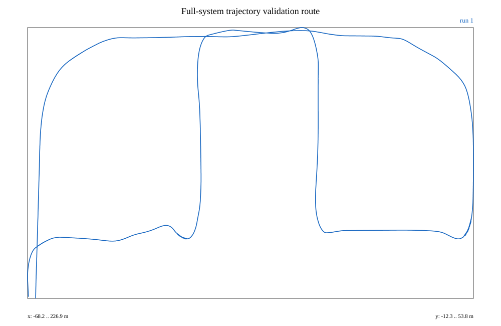
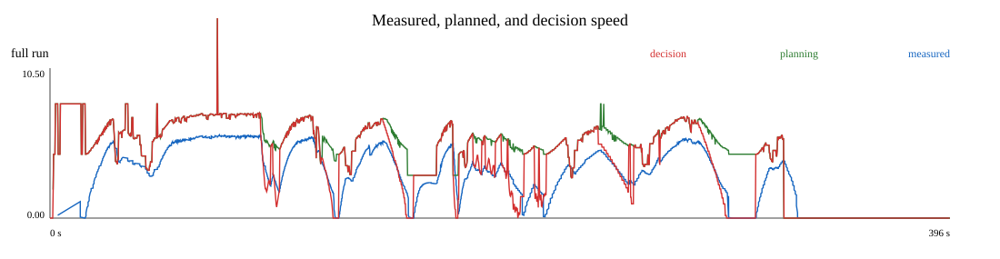
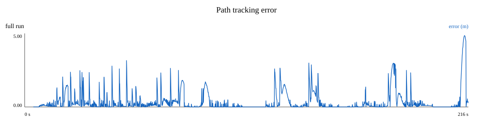
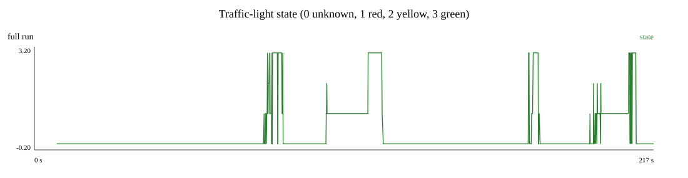
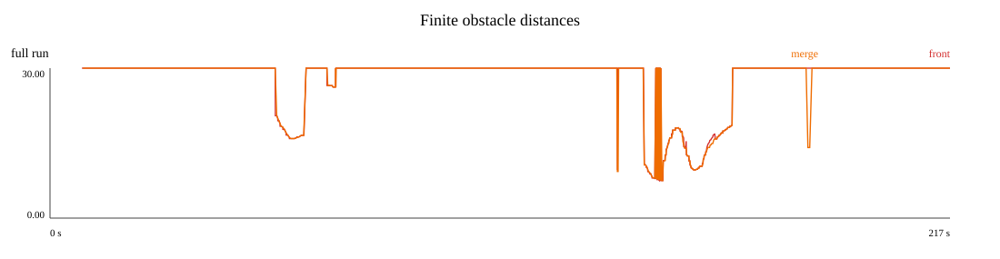
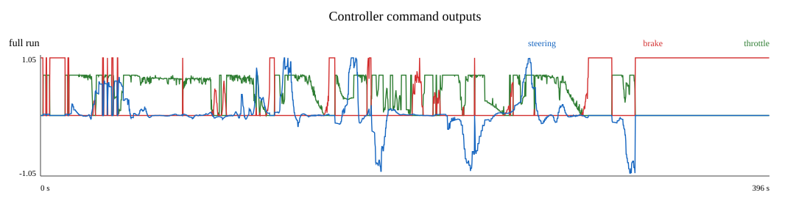

# Autonomous Driving Project Documentation — Team 20

**Course:** Introduction to ROS
**Team:** Lei Fang (03805710), Yida Lyu (03816236), Tao Zhang (03822999),
Jianing Huang (03814771)
**System:** ROS 2 Jazzy / Ubuntu 24.04 / Unity simulator
**Document date:** 2026-08-03

## 1. System overview and design

Team 20 implemented a complete ROS 2 autonomous-driving pipeline for the supplied Unity
urban course. The vehicle follows a validated 64-waypoint route, detects vehicles and
traffic lights without using the semantic camera, generates a dynamically feasible local
trajectory, selects a safe target speed, and controls steering, throttle, and braking.
The production graph is started by `system_bringup/full_system.launch.py`; only
`controller_node` may publish `/car_command`.

The data flow is deliberately separated by responsibility:

```text
Unity sensors -> perception -> observations -----------------------+
Unity pose -> route_manager -> trajectory_generator -> trajectory  |
                               |                  +-----------------+-> decision_making
                               +-> planning speed ------------------+       |
Unity velocity/TF -> controller <--- trajectory + final speed/stop --------+
                          |
                    /car_command -> Unity
```

The route is a deterministic YAML sequence because the assessed map is fixed. Local
geometry is produced by ego projection, Hermite/Bézier smoothing, equal-arc resampling,
and bicycle-model curvature checks. A forward acceleration pass and backward braking pass
create per-point speed and time values in Team 20's `PlannedTrajectory` message. The
controller selects pose and speed from the same lookahead point, applies the more
restrictive decision speed, uses Pure Pursuit laterally and PID longitudinally, and stops
on missing or stale required data.

Perception runs a COCO YOLOv8n ONNX model on the regular left RGB camera. Depth samples
are reconstructed in 3-D, transformed into the RGB optical frame, and reprojected into
vehicle detections to estimate range. Traffic-light candidates are route-gated and
classified with HSV/layout evidence plus temporal filtering. Point-cloud corridor checks
provide an independent geometric safety signal. The semantic camera is disabled in the
production configuration.

Decision making uses an explicit, testable priority:
`emergency braking > traffic-light stop > stale-merge stop > adaptive following >
merge slowdown > planned speed`. This is less general than a learned policy, but its
states, latches, timeouts, and safety fallbacks can be inspected and regression-tested.

## 2. ROS packages and nodes

The table covers every workspace package and every installed ROS node. Nodes marked
“offline tool” or “not production” remain in the repository but are not started during
the assessed run.

| Package | Node(s) | Functionality / ownership |
| --- | --- | --- |
| `simulation` | `JSON_param_reader`; `Unity_ROS_message_Rx`; `ROS_Unity_command_Tx`; `tf_nominal_center`, `tf_sensors`, `tf_depth_camera`, `tf_rgb_camera_left`, `tf_rgb_camera_right` | Course-supplied/reused Unity configuration, TCP sensor reception, UDP command transmission, and static sensor TF. |
| `perception` | `yolo_rgbd_detector_node` | Tao Zhang: YOLO ONNX inference on normal RGB, RGB-D vehicle ranging, route-gated traffic-light selection/classification, and debug observations. |
| `perception` | `occupancy_map_node` | Tao Zhang: depth filtering, point-cloud generation, projected occupancy maps, and obstacle-map diagnostics. |
| external `octomap_server` | `octomap_server` | Reused OctoMap node: converts the filtered cloud into 3-D octomap and projected map topics. |
| `route_manager` | `route_manager_node`; `waypoint_recorder` (offline tool) | Lei Fang: route-file validation, ordered waypoint progress, local path/target, route state, distance, and speed limit; the recorder captures TF poses into route YAML during route authoring. |
| `autonomy_interfaces` | no runtime node | Jianing Huang: Team 20 `TrajectoryPoint` and `PlannedTrajectory` message definitions. |
| `trajectory_generator` | `trajectory_generator_node` | Jianing Huang: route projection, smoothing/resampling, curvature and dynamic feasibility, timed trajectory, path, and planning-speed publication. |
| `decision_making` | `obstacle_monitor_node` | Yida Lyu: fuses the planning-path point-cloud corridor with stable route-gated RGB-D vehicle range and publishes front/merge obstacle distances. |
| `decision_making` | `traffic_light_state_machine_node` | Yida Lyu: applies traffic-light, following, merging, emergency, stale-input, and route-completion rules to publish the final speed and stop intent. |
| `controller` | `controller_node` | Yida Lyu: validates inputs/curvature, performs Pure Pursuit and PID control, bounds commands, safe-stops, and exclusively publishes `/car_command`. |
| `system_bringup` | launch orchestration; `live_visualization`; RViz nodes `driving_overview`, `telemetry_charts` | Shared integration by the team; one launch starts the production graph. Visualization is diagnostic and has no control authority. |
| `dummy_controller` | `dummy_controller_node` (not production) | Course-supplied example controller. It must never run together with Team 20's controller. |

The central interface is the custom `/planning/trajectory`: each ordered point contains
pose, signed curvature, target speed, and relative time. `/planning/path` remains the
geometric interface for RViz and the obstacle corridor. `/planning/target_speed` is only
a planning proposal; `decision_making` publishes the final `/decision/target_speed` and
`/decision/stop_required` consumed by the controller. Team 20 authored both
`TrajectoryPoint.msg` and `PlannedTrajectory.msg`; these explicitly satisfy the
assignment requirement to implement and document an own ROS message type.

## 3. Functional modules and core equations

### 3.1 Simulation and system bringup

The course-supplied simulation package starts Unity, checks the simulator configuration,
receives sensors over TCP, transmits `/car_command` over UDP, and publishes the static
sensor transforms. Team 20's `system_bringup` package composes simulation, perception,
route management, trajectory generation, decision making, control, and optional RViz
views into the single production launch entry point. `enable_motion=false` is the safe
default.

### 3.2 Perception and mapping

`yolo_rgbd_detector_node` uses the normal left RGB camera for YOLOv8n inference. Because
the RGB and depth cameras have different optical centres, a depth pixel is first
back-projected into its camera frame,

```text
X = (u - c_x) Z / f_x,    Y = (v - c_y) Z / f_y,    Z = depth(u,v),
```

then transformed by TF and projected into the RGB image. Points inside a YOLO vehicle
box provide a robust range estimate. Traffic-light detections are filtered by route,
image region, HSV colour/layout evidence, and time. `occupancy_map_node` independently
turns depth into filtered point clouds and projected maps; `octomap_server` provides the
reused 3-D occupancy representation.

### 3.3 Route and trajectory generation

`route_manager_node` validates the fixed 64-waypoint YAML route and publishes ordered
progress, a local path, target pose, route state, waypoint distance, and speed limit.
`trajectory_generator_node` projects the ego pose onto this route, smooths the local
geometry, resamples it by arc length, and computes curvature. The bicycle-model steering
boundary and lateral-acceleration speed cap are

```text
kappa_max = tan(delta_max) / L,
v_cap[i] = min(v_route[i], v_max, sqrt(a_lat,max / |kappa[i]|)).
```

Forward acceleration and backward braking propagation enforce

```text
v[i]^2 <= v[i-1]^2 + 2 a_accel ds,
v[i]^2 <= v[i+1]^2 + 2 a_decel ds,
dt[i] = 2 ds / (v[i-1] + v[i]).
```

Every published `TrajectoryPoint` therefore binds pose, signed curvature, speed, and
relative time. An infeasible profile is rejected instead of silently bypassing a safety
constraint.

### 3.4 Decision making

`obstacle_monitor_node` fuses the planning-path point-cloud corridor with stable RGB-D
vehicle range. `traffic_light_state_machine_node` applies the documented priority
`emergency > traffic light > stale merge > following > merge > planning`. When a stop
boundary is active, its distance envelope is

```text
v_stop = sqrt(2 a_brake max(0, d_waypoint - d_stop)),
v_decision = min(v_planning, v_stop, v_follow, v_merge).
```

State latches and input timeouts prevent a one-frame observation from immediately
releasing a stop.

### 3.5 Vehicle control

The controller selects one trajectory lookahead index for both geometry and profile
speed. Pure Pursuit computes steering from lookahead distance `l_d`, heading error
`alpha`, and wheelbase `L`:

```text
delta = atan(2 L sin(alpha) / l_d).
```

Longitudinal control uses PID with the derivative applied to measured speed to avoid a
target-step derivative kick,

```text
e = v_target - v_measured,
u = K_p e + K_i integral(e dt) - K_d d(v_measured)/dt,
v_target = min(v_trajectory, v_decision).
```

The command is bounded and converted into mutually exclusive throttle/brake output. Any
stale required input, invalid trajectory, decision stop, or disabled-motion state
produces a safe brake command.

## 4. ROS graph and contribution ownership

Grey components in the graph are course-supplied/reused. Coloured clusters identify the
Team 20 owner. Dotted edges show launch ownership; solid edges are runtime data flow.

The PDF contains a readable vector overview. The complete topic-level graph is available
as the full-resolution [`project/docs/ros_graph.svg`](project/docs/ros_graph.svg).

## 5. Results and requirement coverage

The retained 2026-08-01 production run is a reproducible evidence example, not a promise
that every run has identical timing. Its rosbag, logs, hashes, plots, and analysis command
are documented in `Rosbag_reproduction/`; machine-readable results are in
`project/mission_results/metrics.json`.

| Result | Recorded evidence |
| --- | --- |
| Route and timing | Reached waypoint 63; `route_complete=true`; mission time 210.231 s from first forward command and 210.051 s from first measured motion. |
| Build/tests | All nine packages built; 216 tests, 0 failures, 0 errors, 1 expected skip. |
| Trajectory | 2,115 messages / 70,008 points; no invalid values or non-monotonic point times; full constraint audit passed. |
| Dynamic limits | Maximum curvature 0.217622 1/m against 0.217704 1/m; lateral acceleration 3.0000 m/s²; acceleration 2.0008 m/s²; deceleration 3.0000 m/s², within configured tolerances. |
| Availability | 0.33% empty route-stage trajectories; longest continuous empty interval 0.596 s; maximum message gap 0.192 s; all availability gates passed. |
| Traffic lights | 1,386 observations and recorded stop/release behavior at controlled waypoints 25, 32, 52, and 59. |
| Vehicles/safety | Event1 continuous following; Event2 minimum obstacle distance 7.502 m; no collision, route departure, simultaneous throttle/brake, emergency entry, or pre-completion process death. |













### Result analysis

The route trace provides direct spatial evidence that the vehicle completed the intended
course and reached waypoint 63. The speed plot shows the separation of responsibilities:
the trajectory generator publishes the dynamically feasible profile, decision making
can reduce it for traffic rules or obstacles, and measured velocity follows the resulting
command with normal closed-loop lag rather than instantaneously.

Tracking error over the full mission was `0.6676 m` RMSE and `1.6717 m` at the 95th
percentile; the maximum recorded error was `3.1212 m`. The traffic-light trace contains
1,386 observations (`1,085 unknown`, `194 red`, `7 yellow`, `100 green`) and the bag
records stop requests at waypoints 25, 32, 52, and 59. Unknown dominates because lights
are route-gated and small/distant detections are deliberately not treated as permission
to proceed. The four stop events occurred at approximately `1.845`, `3.937`, `3.338`, and
`3.996 m` from their active waypoint boundaries.

The audit found no non-finite trajectory point or non-monotonic point time in 70,008
points. The `0.33%` empty-trajectory fraction and `0.596 s` longest continuous empty
interval show that curvature-gate fallbacks were brief; an empty message makes the
controller brake, so availability is reported together with constraint correctness.
Finite obstacle ranges appear only when a relevant target is detected; Event2 reached a
minimum of `7.502 m` without collision or emergency entry. The command-output trace
shows bounded steering and mutually exclusive longitudinal actuation: no retained sample
contained throttle and brake simultaneously. Complete result definitions are retained in
[`project/mission_results/`](project/mission_results/README.md).

### Known limitations and incomplete extensions

All mandatory functional areas were implemented and exercised by the retained validation
run. The following limitations are documented because they constrain generalization:

- the distributed model is the COCO-pretrained YOLOv8n baseline, not a custom model
  fine-tuned on a Team 20 Unity dataset; small traffic lights therefore require a low
  detector threshold, route gates, per-intersection ROIs, colour/layout evidence, and
  temporal filtering;
- a changed map, route, camera resolution, or field of view requires route/ROI
  recalibration and complete revalidation; the fixed YAML route does not globally replan;
- trajectory feasibility does not model jerk, tyre-force coupling, steering rate,
  drivetrain lag, or jointly optimize obstacle avoidance; obstacle risk is handled by
  longitudinal decision and safe stopping rather than free-space path replanning;
- stale or missing sensor data deliberately produces conservative braking, so short TCP
  or depth interruptions can cause a transient stop;
- large raw validation bags are managed through Git LFS/reproduction records rather than
  embedded in this PDF, and a separate no-event control run would strengthen comparison.

## 6. Team contribution and reused code

| Member | Primary contribution | Traceable artifacts |
| --- | --- | --- |
| Lei Fang (03805710) | `route_manager`; integration | Route model/YAML, validation, waypoint progress, local route/context, speed limits, and tests. |
| Yida Lyu (03816236) | `decision_making`, `controller`; integration | Obstacle fusion, behavior state machine, Pure Pursuit/PID, safety handling, and decision-to-command interfaces. |
| Tao Zhang (03822999) | `perception`; integration | YOLO RGB-D ROS integration, traffic-light processing, vehicle ranging, point clouds/maps, and perception interfaces. |
| Jianing Huang (03814771) | `trajectory_generator`, `autonomy_interfaces`; integration and project documentation | Projection, smoothing/resampling, constrained time parameterization, custom messages, planner interfaces, and this documentation. |

All four members contributed at their module boundaries to topic/configuration alignment,
`system_bringup`, end-to-end testing, and dynamic validation. No more granular split of
shared integration work is claimed.

Team 20 wrote or substantively developed the project-specific code in `perception`,
`route_manager`, `autonomy_interfaces`, `trajectory_generator`, `decision_making`,
`controller`, and `system_bringup`, including their configuration and tests. The
following content is external and is not claimed as original Team 20 code:

- the Unity simulator, original ROS simulation bridge, and `dummy_controller`, supplied
  by the course;
- YOLOv8n architecture/COCO weights and Ultralytics export tooling (AGPL-3.0 terms apply
  to the distributed perception/model integration record);
- ONNX Runtime (MIT), OpenCV, ROS 2/rclcpp/rclpy, TF2, OctoMap, Eigen, NumPy, and PyYAML;
- nlohmann/json and the Unity player/runtime bundled with the course-supplied simulation;
- the public Pure Pursuit, PID, Hermite/Bézier, constant-acceleration, and finite-state
  machine methods. Team 20 owns its implementations, integration, tests, and tuning, not
  the underlying algorithms.

The distributed model is `src/perception/models/yolov8n.onnx` (640×640, 80 COCO classes,
SHA-256 `8707bb120b03a6bf8a199e7c35c6d47ad5f83de4fdd233110db270f7d355a3be`).

## Bibliography

1. Technical University of Munich, *Introduction to ROS: Autonomous Driving Project
   Assignment*, `AutonomousDriving.pdf`, 2026.
2. R. C. Coulter, *Implementation of the Pure Pursuit Path Tracking Algorithm*,
   CMU-RI-TR-92-01, Carnegie Mellon University, 1992.
3. G. Farin, *Curves and Surfaces for CAGD: A Practical Guide*, 5th ed., Morgan
   Kaufmann, 2002.
4. K. J. Åström and T. Hägglund, *PID Controllers: Theory, Design, and Tuning*, 2nd ed.,
   Instrument Society of America, 1995.
5. Open Robotics, *ROS 2 Jazzy documentation: Topics, Services, and Actions*,
   https://docs.ros.org/en/jazzy/, accessed 2026-08-01.
6. Ultralytics, *Model Export with Ultralytics YOLO*,
   https://docs.ultralytics.com/modes/export/, accessed 2026-08-01.
7. Microsoft, *ONNX Runtime C++ documentation*,
   https://onnxruntime.ai/docs/get-started/with-cpp.html, accessed 2026-08-01.
8. A. Hornung et al., “OctoMap: An Efficient Probabilistic 3D Mapping Framework Based on
   Octrees,” *Autonomous Robots*, 34, 189–206, 2013.
