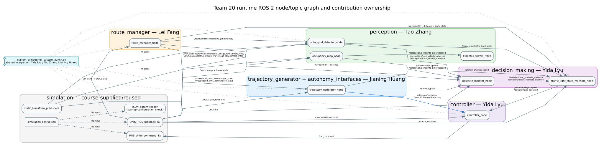

# 项目状态：full-system-v1.9.0

更新日期：2026-08-01

> 本文是 full-system-v1.9.0 的书面总结，覆盖全系统架构、感知模型、路线与轨迹、
> 决策与控制设计、成员分工、Team 20 自研/实质修改代码、课程提供代码和第三方复用
> 内容。各包 README 保留更详细的 topic、参数、测试和调优说明。

## 1. 已实现功能与要求覆盖

项目已使用 `RGB + YOLOv8n + Depth/PointCloud` 替代语义分割相机完成目标检测。
生产配置中的 `segCamera.enabled` 为 `false`；YOLO 节点只读取普通 RGB、深度、
相机内参、TF 和少量路线信息，不读取语义图像或语义标签。

当前实现能够：

- 从 YAML 加载经过闭环验证的 64 个 waypoint，发布局部路线、路线语义、目标距离和
  速度上限，并在 waypoint 63 发布 `route_complete`；
- 将车辆投影到有序路线，使用 Hermite/Bézier 几何平滑、等弧长重采样、连续性融合
  和质量门禁生成 `/planning/path`；
- 按曲率/横向加速度限制逐点速度，执行前向加速与反向制动传播，积分严格递增的时间，
  并通过 Team 20 自定义的 `/planning/trajectory` 消息发布结果；
- 使用 C++ ROS 2 节点和 ONNX Runtime 运行固定尺寸的 YOLOv8n ONNX 模型；
- 在普通 RGB 图像中检测 COCO `car`、`bus`、`truck` 和 `traffic light`；
- 将深度像素通过三维重建、TF 和 RGB 重投影放入 YOLO 车辆框中，估计前车距离；
- 在 waypoint 25、32、52、59 选择控制本车道的交通灯，而不是对向或横向交通灯；
- 从检测框内的 HSV 颜色、灯泡上下布局和多帧结果判断红、黄、绿灯；
- 对 waypoint 25 的“小检测框没有完整框住下方绿灯灯泡”问题进行补充识别，
  同时拒绝交通灯下方的大块绿色路牌；
- 在 Event1 的 waypoint 17--20 窗口内稳定关联 YOLO/RGB-D 前车，允许经过路线
  门控的视觉距离在点云暂时无法匹配时继续参与纵向控制；
- 跨越短时 YOLO 漏检保留前车关联和安全跟车目标，避免目标速度在跟车速度与
  14 m/s 巡航速度之间跳变；
- Event1 漏检保持期严格保留最后一条安全跟车命令，并在稳定前车具有富余间距时
  允许逐渐恢复，避免使用持续下降的本车速度重复计算目标并把它逐步压到零；
- 取消 waypoint 25、32、52、59 红绿灯前固定 3 m/s 的远场限速，改用统一的
  距离制动包络逐渐减速；
- 分别在 waypoint 25/32/52/59 前约 2.0/4.0/3.4/4.0 m 命令停车，并通过
  waypoint 25 的局部路线到达半径保证 2 m 停车线的距离参考不会提前切换；
- 使用显式状态机按“紧急制动 > 交通灯停车 > stale merge 停车 > 自适应跟车 >
  汇入减速 > 规划速度”的优先级生成最终目标速度；
- 使用 Pure Pursuit 跟踪轨迹，使用 derivative-on-measurement PID 调节速度，并且
  只由真实 controller 发布 `/car_command`；
- 在检测、模型、TF 或深度数据异常时发布保守的安全状态。

这些功能共同覆盖课程考核所需的系统范围：不使用 semantic camera 的感知、路线
完成、交通灯响应、车辆跟随、可行轨迹规划、闭环控制和可追溯的安全行为。是否满足
要求应由可重复的验收标准判断，而不是由某一次任务的精确时间、速度、距离或消息数
定义。第 6 节定义验收要求，文档最后一节再给出最近一次完整运行作为证据示例。

## 2. 总体架构、模型与设计选择

### 2.1 系统分层和权威接口

```text
Unity / simulation bridge
  ├─ RGB + Depth + CameraInfo + TF ──> perception
  │       ├─ YOLO RGB-D vehicle/light observations ──────────────┐
  │       ├─ point cloud ──────────────> obstacle_monitor ────────┤
  │       └─ occupancy map / OctoMap ──> visualization/diagnostics
  ├─ world -> OurCar/INS TF ──> route_manager ──> trajectory_generator
  │                                  │                    │       │
  │                                  └─ route context ────┤       │
  │                                                       └─ 带时间的可行轨迹
  └─ vehicle twist/TF ────────────────────────────────────────────┤
                                                                  v
                                                        decision_making
                                                    final speed + stop intent
                                                                  │
                planned trajectory + vehicle twist/TF ────────────┤
                                                                  v
                                                              controller
                                                                  │
                                                             /car_command
                                                                  │
                                                                  v
                                                        simulation / Unity
```

包边界是设计的一部分：`perception` 只报告观察结果，`route_manager` 只提供有序路线
上下文，`trajectory_generator` 生成已校验路径和动态可行速度剖面，`decision_making`
组合交通规则与
障碍物行为，`controller` 才把最终意图变成油门、转向和制动。`/planning/target_speed`
先进入决策层，不是最终控制速度；controller 使用所选轨迹 lookahead 点自带的速度，
再由 `/decision/target_speed` 取更严格的上限。`/car_command` 必须只有一个权威
publisher，避免多个控制器相互覆盖。
生产 bringup 把同一组轴距和最大转向角注入规划器与控制器。控制器还会独立按
`tan(maximum_steering_angle) / wheelbase` 拒绝超出自身边界的轨迹，因此单边 override
会安全失败。

下表按 PDF 要求简述每个生产 package 和 ROS node。可视化节点也列在表中，但不参与
自动驾驶决策。

| Package | 生产节点 | 职责与归属 |
| --- | --- | --- |
| `simulation` | `JSON_param_reader`、`Unity_ROS_message_Rx`、`ROS_Unity_command_Tx`、static TF publishers | 课程提供/复用：仿真配置、Unity 传感器传输、控制命令传输和传感器 TF。 |
| `perception` | `yolo_rgbd_detector_node` | Tao Zhang：普通 RGB YOLO 推理、RGB-D 测距、交通灯选择/分类和观测 topic。 |
| `perception` | `occupancy_map_node`、`octomap_server` | Tao Zhang：深度点云过滤和 2-D/3-D 诊断地图；OctoMap 本身为复用组件。 |
| `route_manager` | `route_manager_node` | Lei Fang：路线加载校验、有序进度、局部路线、waypoint 语义、距离和限速。 |
| `autonomy_interfaces` | 无运行节点 | Jianing Huang：Team 20 的 `TrajectoryPoint` 和 `PlannedTrajectory` 消息定义。 |
| `trajectory_generator` | `trajectory_generator_node` | Jianing Huang：路线投影、平滑/重采样、转向/曲率校验、动态时间参数化和轨迹发布。 |
| `decision_making` | `obstacle_monitor_node` | Yida Lyu：规划走廊点云距离及视觉/路线融合，输出前方和汇入障碍距离。 |
| `decision_making` | `traffic_light_state_machine_node` | Yida Lyu：按安全优先级执行行为状态机，输出最终速度/停车意图。 |
| `controller` | `controller_node` | Yida Lyu：轨迹索引一致的 Pure Pursuit、最严格速度选择、PID、安全停车和 `/car_command`。 |
| `system_bringup` | launch 编排；可选 `live_visualization`、`driving_overview`、`telemetry_charts` | Yida/Tao/Jianing 共享集成：启动生产图和可选诊断；可视化没有控制权限。 |
| `dummy_controller` | 生产环境不启动 | 课程提供示例，保持不变，绝不与 Team 20 controller 同时启动。 |

### 2.2 主要模型和取舍

| 设计位置 | 当前选择 | 选择理由 | 代价/限制 |
| --- | --- | --- | --- |
| 全局路线 | 固定地图上的 64-waypoint YAML 路线 | 课程地图固定，路线可复现、可检查、可逐点配置语义和速度 | 地图或任务改变时不能自动全局重规划 |
| 局部轨迹 | ego 投影 + Hermite/Bézier 平滑 + 自行车模型曲率门禁 + 前向/反向时间参数化 | 在不引入 MPC 的前提下，得到满足转向、横向加速度和纵向加/减速约束的可测试轨迹；无法满足的实测初速度边界会被明确拒绝 | 包络未建模 jerk、轮胎摩擦圆、转向速率和动力总成；避障仍在下游处理 |
| 目标检测模型 | 普通 RGB 上的 COCO YOLOv8n ONNX，C++/ONNX Runtime CPU 推理 | 不依赖 Unity semantic camera；轻量模型可随项目直接运行 | 小交通灯与 Unity 域差异需要路线门控、HSV 和时序补偿 |
| 距离与障碍物 | RGB-D 重投影 + 规划路径点云走廊 + 近场安全走廊 | YOLO 提供类别，Depth/PointCloud 提供距离和几何一致性，互相降低误检 | 传感器缺帧时会保守停车；特定事件窗口需要经过验证的直接视觉 fallback |
| 行为决策 | 可解释状态机、锁存和显式优先级 | 红绿灯、跟车、汇入和紧急状态可追踪、可单元测试，安全优先级明确 | 不具备学习策略对未知场景的泛化能力 |
| 横向控制 | Pure Pursuit + 随车速变化的 lookahead | 对固定路线足够稳定，公式简单，便于调参和检查转向方向 | 高动态/极限操纵能力弱于 MPC |
| 纵向控制 | PID，微分项作用于测量速度 | 实现透明；避免目标速度阶跃造成 derivative kick | 依赖 Unity 速度反馈和场景相关调参 |
| 故障处理 | 输入超时、stop latch、有限输出和 safe-stop brake | stale/missing 数据不会继续沿用旧控制命令 | TCP/Depth 短暂抖动可能造成保守的瞬时停车 |

### 2.3 感知与纵向行为细节

```text
普通左 RGB 图像
  └─ YOLOv8n ONNX
      ├─ vehicle bbox
      │    └─ Depth 像素 -> 3-D -> TF -> RGB 重投影
      │         └─ bbox 内近表面稳健距离 -> 前车检测/距离
      └─ traffic-light bbox
           └─ 路线门控 + 分路口 ROI/目标位置
                └─ HSV + 灯泡布局 + 必要时向下扩展颜色区域
                     └─ 多帧稳定器 -> RED/YELLOW/GREEN/UNKNOWN
```

这里的 PointCloud/Depth 不负责识别“这是什么物体”。YOLO 负责类别和二维框；
Depth/PointCloud 负责距离、三维位置和几何安全校验，因此在加入 YOLO 后仍然有用。

#### 2.3.1 车辆检测和测距

- YOLO 使用 COCO 类别 ID `2/5/7`，对应 `car/bus/truck`。
- RGB 左相机和 Depth 相机存在约 0.2 m 基线，不能直接使用相同像素坐标取深度。
- 节点将采样的 Depth 像素反投影到三维，经 TF 变换到 RGB 光学坐标系后重新投影。
- 只保留车辆框裁剪区域中的有效点，至少要求 20 个点，并使用 20% 分位距离减少
  背景点和离群点影响。
- 还会检查有效距离和横向走廊，避免将路旁或对向车辆当作本车道前车。

#### 2.3.2 交通灯检测和选择

- 交通灯单独使用 `0.01` 的低置信度阈值，因为远处目标可能只有约 `7 x 15 px`；
  车辆检测仍使用 `0.25`，不会因交通灯阈值而放宽。
- 只有 waypoint 25、32、52、59 且距离路口不超过 20 m 时，交通灯结果才能影响
  后续状态。
- waypoint 25、52、59 使用独立的透视 ROI 和期望目标位置，排除画面边缘的
  对向灯、横向灯和无关高置信度灯。
- 路线管理器越过目标 waypoint 后，门控会保持一个 waypoint，避免车辆刚停稳时
  因 waypoint 已更新而不再观察该灯。
- 明确的绿灯可在连续 2 帧后确认；普通/模糊状态需要 4 帧。非绿灯会立即撤销
  之前的通行许可，使系统能快速响应红灯。

#### 2.3.3 waypoint 25 绿灯漏检与绿色路牌抑制

YOLO 的小交通灯框有时只包含红灯和外壳，未完整包含最下方的绿色灯泡。当前修复
不会把扩展后的大区域直接当成普通交通灯框，而是：

1. 保留原 YOLO 框用于常规 HSV 和灯泡布局分类；
2. 仅为补充绿色证据对小框增加少量水平边距并向下扩展；
3. 在扩展区域中只接受高亮、高饱和、尺寸紧凑且位于合理下方位置的绿色连通区域；
4. 要求候选不接触裁剪边界，并限制面积和形状；
5. 依据原检测框面积归一化分数，再交给严格绿灯阈值判断。

因此，小而亮的下方绿灯灯泡能够被补回；占据大面积、形状过宽或触碰裁剪边界的
绿色路牌不会成为放行证据。相应单元测试已经覆盖“绿灯框被裁短”“扩展碰到图像
边界”和“下方大块绿色路牌”三种情况。

#### 2.3.4 Event1 前车检测与连续跟车

Event1 车辆在 waypoint 17--20 内位于本车道相机走廊，但预处理点云可能暂时无法
提供一致的路径距离。当前障碍物融合和决策逻辑作了以下更新：

- `vision_direct_control_waypoint_ids` 包含 waypoint 17--20；在这个经过验证的
  窗口内，稳定且位于走廊内的 YOLO/RGB-D 车辆距离可以直接参与前车控制；
- `vision_vehicle_detection_hold_time=1.3 s`，短时检测缺帧时保留最后一次可信
  关联，避免回到全速巡航后又重新刹车；
- 跟车在 20 m 内激活，并使用 2.2 s 时距、距离误差和滤波后的距离变化率连续
  计算目标速度；
- Event1 的目标速度下降斜率限制为 `2.0 m/s²`，从当前车速开始平滑减小；
- 20 m 激活边界外保留 2 m 释放滞回，减少边界附近反复进入/退出跟车；
- waypoint 20 后停止 Event1 的视觉直接控制，因为前车开始驶向路边，避免产生
  第二次不必要制动；
- 独立的近场紧急制动仍保留，不会被平滑跟车逻辑削弱。

#### 2.3.5 红绿灯限速与渐进刹车

waypoint 25、32、52、59 的路线远场速度上限均为 `8 m/s`。这消除了切换到
`stop_zone` 时由路线层直接产生的 `14 -> 3 m/s` 目标速度阶跃。红灯、黄灯或
UNKNOWN 状态下，决策层按以下包络限制目标速度：

```text
v_target = min(planning_speed, 8.0, sqrt(2 * 0.7 * remaining_distance))
remaining_distance = waypoint_distance - active_stop_distance
```

因此车辆会随停车余量连续减速，而不是一进入路口 waypoint 就全力制动。当前停车
边界如下：

| 受控 waypoint | 路线远场上限 | 停车边界 | 说明 |
| ---: | ---: | ---: | --- |
| 25 | 8 m/s | 2.0 m | 局部 `reach_distance=1.5 m`，防止全局 3 m 到达半径提前切换到 waypoint 26 |
| 32 | 8 m/s | 4.0 m | waypoint 33--35 的 3 m/s 转弯限速保持不变 |
| 52 | 8 m/s | 3.4 m | 停车线较默认值前移 0.6 m |
| 59 | 8 m/s | 4.0 m | 最初验证距离制动包络的末端红绿灯 |

绿灯确认后解除交通灯制动限制，后续弯道 waypoint 自身的速度限制仍然有效。

### 2.4 轨迹规划模型与接口

规划器把几何处理和时间参数化分开。路线投影、平滑、等弧长重采样和质量校验完成后，
每个点先得到速度上限：

```text
v_cap[i] = min(route_limit, max_speed,
               sqrt(max_lateral_acceleration / abs(curvature[i])))
```

几何还必须满足与 controller 相同的自行车模型转向限制：

```text
abs(curvature[i]) <= min(max_curvature,
                         tan(maximum_steering_angle) / wheelbase)
```

生产参数 `wheelbase=2.63 m`、`maximum_steering_angle=0.52 rad`，因此有效曲率上限约为
`0.2177 1/m`；这些参数有意与 controller 保持一致。

前向传播满足 `v[i]^2 <= v[i-1]^2 + 2*a_accel*ds`；反向传播满足
`v[i]^2 <= v[i+1]^2 + 2*a_decel*ds`，因此能在弯道之前提前减速，并在
`route_complete` 处满足零终端速度。点时间通过 `dt = 2*ds/(v[i-1]+v[i])` 积分。
生产参数为横向加速度 3.0 m/s²、纵向加速度 2.0 m/s²、纵向减速度 3.0 m/s²。
第一个点的实测速度是不可被反向传播静默降低的硬边界。如果剩余距离不足以到达更低
速度上限，规划器会把该周期标为不可行，发布空轨迹和零标量目标；controller 会安全
停车，直到重新得到可达剖面。

Team 20 的 `autonomy_interfaces/msg/PlannedTrajectory` 是按顺序排列的
`TrajectoryPoint` 数组，每点包含 pose、有符号曲率、目标速度和相对起点时间。轨迹是
持续刷新的数据流，因此选择 topic，而不是会引入同步请求/响应耦合的 service。
controller 直接订阅此消息：Pure Pursuit 的同一个 lookahead 索引同时选择 pose 和剖面
速度。标量 `/planning/target_speed` 从约束剖面前方 4 m 的样本取得并进入
`decision_making`；controller 取所选轨迹速度和 `/decision/target_speed` 中更小的值。
标准 `/planning/path` 仍供障碍物走廊和 RViz 使用。

`velocity_profile.py` 保持纯计算且不依赖 ROS。聚焦单元测试覆盖转向角推导的曲率上限、
横向速度上限、加速可达性、弯前制动、不可达初始条件、终点停车、时间单调性和 ROS
消息序列化；rosbag 分析检查运行期接口。

### 2.5 v1.9.0 代码质量与文档统一

本版本统一了 Team 20 代码风格，记录新增加的 Team 20 轨迹消息，并将其接入
controller-facing 接口：

- 修复 `route_manager` 的 flake8 和 PEP 257 问题，并补充异常路线输入测试；
- 使用根目录 `.editorconfig` 和 `project/CODE_STYLE.md` 统一 Python、C++、launch、
  测试和工具代码的可读性规则；
- 新增 `project/tools/check_code_quality.sh`，集中执行 Python flake8/PEP 257 与 C++
  cpplint/uncrustify；
- 将项目自带的 `dummy_controller` 保持为 v1.8.0 基线，不归入 Team 20 风格修改；
- 对 vendored ONNX Runtime、JSON 头文件和其他第三方内容设置编辑器保护，避免保存时
  产生无关格式变化；
- 完善总 README 和 `src/README.md`，记录四位成员分工、项目功能、依赖安装、
  clone/pull、构建、测试、完整运行和故障排查步骤。

## 3. 关键文件

```text
# 全系统主链路
src/route_manager/route_manager/route_manager_node.py
src/route_manager/route_manager/route_map.py
src/route_manager/route_manager/route_progress.py
src/route_manager/config/route_map.yaml
src/trajectory_generator/trajectory_generator/path_processor.py
src/trajectory_generator/trajectory_generator/velocity_profile.py
src/trajectory_generator/trajectory_generator/trajectory_generator_node.py
src/trajectory_generator/test/test_time_parameterization.py
src/autonomy_interfaces/msg/TrajectoryPoint.msg
src/autonomy_interfaces/msg/PlannedTrajectory.msg
src/decision_making/decision_making/obstacle_monitor_node.py
src/decision_making/decision_making/traffic_light_state_machine.py
src/controller/src/control_core.cpp
src/controller/src/controller_node.cpp
src/system_bringup/launch/full_system.launch.py

# 感知和模型
src/perception/src/yolo_rgbd_detector_node.cpp
src/perception/include/perception/yolo_postprocess.hpp
src/perception/include/perception/traffic_light_route_gate.hpp
src/perception/include/perception/traffic_light_stability_filter.hpp
src/perception/config/yolo_rgbd.yaml
src/perception/launch/perception.launch.py
src/perception/models/yolov8n.onnx
src/perception/models/README.md
tools/collect_yolo_frames.py
tools/export_yolo_onnx.py
tools/train_yolo_sim.py
datasets/team20_yolo.yaml
datasets/team20_yolo/README.md
requirements-yolo-training.txt

# v1.9.0 代码质量与项目级文档
../.editorconfig
CODE_STYLE.md
tools/check_code_quality.sh
tools/analyze_mission_run.py
docs/ros_graph.svg
mission_results/README.md
mission_results/metrics.json
../README.md
src/README.md

# Event1、路口速度与制动配置/测试
src/decision_making/config/traffic_light_state_machine.yaml
src/decision_making/test/test_traffic_light_state_machine.py
src/route_manager/route_manager/route_progress.py
src/route_manager/config/route_map.yaml
src/route_manager/test/test_route_progress.py
src/route_manager/test/test_route_safety_geometry.py
```

## 4. 成员分工、Team 20 代码与复用内容

“Team 20 代码”表示团队在本项目中编写或实质修改的实现、配置、测试和集成逻辑，
不表示团队发明了所采用的公开算法。课程提供代码和第三方依赖即使因 ROS 2 兼容、
格式或集成而被修改，原始归属也不会转移给 Team 20。

### 4.1 Who did what?

| 成员 | 学号 | 主要责任 | 可追踪的模块/产物 |
| --- | --- | --- | --- |
| Lei Fang | 03805710 | `route_manager` | `src/route_manager`：路线 YAML、waypoint recorder、路线加载/校验、进度判定、局部路线和 route tests |
| Yida Lyu | 03816236 | `decision`、`controller`、part of integration | `src/decision_making`、`src/controller`：状态机、障碍物行为、最终目标速度、Pure Pursuit、PID、安全停车和 decision-to-command 接口 |
| Tao Zhang | 03822999 | Perception、part of integration | `src/perception`：YOLO RGB-D、交通灯颜色/时序、车辆距离、点云/occupancy、模型配置和 perception-to-decision 接口 |
| Jianing Huang | 03814771 | `Trajectory_Generator`、part of integration、全项目文档 | `src/trajectory_generator`、`src/autonomy_interfaces`：路线投影、平滑/重采样、连续性/质量门禁、约束时间参数化、自定义轨迹消息和 route-to-planning 接口；全仓库项目文档 |

Yida Lyu、Tao Zhang、Jianing Huang 的 integration 是共享工作，包括各自模块边界的
topic/config 对齐、`system_bringup` 联调、端到端测试和动态验证。全仓库项目文档由
Jianing Huang 编写。团队没有提供共享 integration 工作的更细个人拆分，因此本文
不虚构更细粒度的个人归属。

### 4.2 全系统归属表

| 组件 | 归属类别 | Team 20 的工作 / 复用边界 |
| --- | --- | --- |
| `route_manager` | Team-written / substantively developed | 路线模型、记录工具、加载校验、进度与越点判定、局部路线、参数、测试和文档；负责人 Lei Fang |
| `autonomy_interfaces` 与 `trajectory_generator` | Team-written / substantively developed | Team 20 自定义消息、路线投影、Hermite/Bézier 应用、重采样、连续性/质量验证、曲率和加减速约束时间参数化、fallback、测试和文档；负责人 Jianing Huang |
| `decision_making` | Team-written / substantively developed | 交通灯状态机、障碍物融合、跟车/汇入/紧急优先级、timeout/latch、测试和文档；负责人 Yida Lyu |
| `controller` | Team-written / substantively developed | Pure Pursuit/PID 的项目实现、输入检查、输出限幅、安全停车、参数、测试和文档；负责人 Yida Lyu |
| `perception` 中 YOLO RGB-D 和项目映射逻辑 | Team-written / substantively developed around reused libraries/model | ROS 节点、RGB-D 重投影、候选选择、HSV/时序规则、occupancy 输出、配置、测试和文档；负责人 Tao Zhang |
| `system_bringup`、项目配置、集成测试/文档 | Team integration | 单入口 launch、模块开关、安全默认值、RViz、接口联调和验证；Yida/Tao/Jianing shared integration |
| `simulation` / Unity bridge and assets | Course-supplied, retained/reused | 提供传感器/车辆状态和命令传输；Team 20 通过 `system_bringup` 和项目配置调用该包，不把 simulator、bridge 或原始 ROS 2 port 声明为自研 |
| `dummy_controller` | Course-supplied, not production | 示例控制器，保持项目基线，不属于 Team 20 生产控制或代码风格评分范围 |
| `.editorconfig`、`CODE_STYLE.md`、质量门禁和项目级 README | Team 20 shared deliverables | 统一风格、质量检查、可追踪性和运行/发布说明；未按个人进一步拆分 |

复用算法和实现边界：

| 方法/依赖 | 复用内容 | Team 20 实现内容 |
| --- | --- | --- |
| Pure Pursuit / PID | 公开控制方法和数学原理 | Yida Lyu 在本项目中的 C++ 实现、ROS 适配、安全检查和参数调优 |
| Hermite / Bézier interpolation 与恒加速度可达性公式 | 公开几何和运动学原理 | Jianing Huang 的路线裁剪、切线约束、曲线拼接、重采样、质量门禁、连续性、前后向约束传播、ROS 接口和项目调参 |
| Finite-state machine pattern | 通用软件设计模式 | Yida Lyu 的交通灯、跟车、汇入、紧急制动状态/优先级/锁存实现 |
| YOLOv8n / COCO weights | Ultralytics 网络、预训练权重和类别知识 | Tao Zhang 的 ROS 2 ONNX 推理集成、RGB-D 测距、路线门控和交通灯后处理 |
| ROS 2 / TF / OpenCV / ONNX Runtime / OctoMap | 第三方框架和库 | Team 20 的节点、topic、参数、变换、配置和系统集成代码 |

### 4.3 Team 20 编写/修改的 YOLO 集成代码

| 内容 | 文件 | Team 20 的工作 |
| --- | --- | --- |
| ROS 2 YOLO RGB-D 节点 | `src/perception/src/yolo_rgbd_detector_node.cpp` | 图像订阅、ONNX Runtime 调用、结果发布、RGB-D 重投影、车辆距离、交通灯候选选择和调试输出 |
| YOLO 后处理 | `src/perception/include/perception/yolo_postprocess.hpp` | letterbox 坐标还原、兼容多种 YOLO 输出布局、按类别 NMS、HSV/布局灯色分类、waypoint 25 补充绿灯和绿色路牌抑制 |
| 路口与时间逻辑 | `traffic_light_route_gate.hpp`、`traffic_light_stability_filter.hpp` | 四个路口的激活/越点保持、快速撤销绿灯许可、多帧稳定确认 |
| 参数和启动集成 | `yolo_rgbd.yaml`、`perception.launch.py` 中 YOLO 相关部分、`CMakeLists.txt` 中 YOLO/ONNX Runtime 相关部分 | 类别、阈值、ROI、话题、模型路径、节点和动态库安装配置 |
| 数据工具封装 | `collect_yolo_frames.py`、`train_yolo_sim.py`、`export_yolo_onnx.py`、dataset YAML/README | ROS 图像采集以及对 Ultralytics 训练/导出 API 的项目化封装 |

上述代码是围绕第三方模型和库编写的项目逻辑。特别是
`tools/train_yolo_sim.py` 和 `tools/export_yolo_onnx.py` 只是调用 Ultralytics
公开 API 的本地封装；训练器、网络结构、损失函数和导出器本身不是 Team 20 的代码。

### 4.4 复用的开源模型、代码和库

| 第三方内容 | 在本项目中的用途 | 版本/来源证据 | 许可证与归属说明 |
| --- | --- | --- | --- |
| Ultralytics YOLOv8n | 检测网络结构、COCO 预训练权重；离线训练和 ONNX 导出 | `yolov8n.onnx`、`requirements-yolo-training.txt`、三个工具脚本 | 当前仓库文档记录为默认 AGPL-3.0；模型和 Ultralytics 实现不属于 Team 20 |
| COCO 预训练内容 | 当前模型的初始类别和预训练知识 | 配置使用 80 类及 COCO 类别 ID | 数据集及其标注不是 Team 20 创建；报告中应注明模型为 COCO-pretrained，不应把 COCO 数据写成自有数据 |
| Microsoft ONNX Runtime CPU | C++ 运行 ONNX 模型 | 仓库内 vendored `1.22.0` | MIT；保留 `third_party/onnxruntime/LICENSE` 和 `ThirdPartyNotices.txt` |
| OpenCV | letterbox、图像处理、NMS、HSV、调试绘图 | 当前系统版本 `4.6.0` | 系统 Debian 包声明为 Apache-2.0 AND BSD-3-Clause，并包含其他第三方组件声明 |
| ROS 2 Jazzy API | 节点、消息、参数、TF 和 launch 接口 | `rclcpp`、`sensor_msgs`、`tf2_ros` 等依赖 | 外部 ROS 2 包；本项目只调用其 API，遵守各 ROS 包自身许可证 |
| NumPy、PyYAML、rclpy | 采集/训练辅助脚本 | Python imports 和 training requirements | 外部 Python 包；不属于运行时 C++ YOLO 节点 |

### 4.5 模型与许可证记录

当前随项目分发的模型信息：

```text
file:    src/perception/models/yolov8n.onnx
size:    12,824,062 bytes
sha256:  8707bb120b03a6bf8a199e7c35c6d47ad5f83de4fdd233110db270f7d355a3be
input:   fixed 640 x 640
classes: 80 COCO classes
runtime: Microsoft ONNX Runtime 1.22.0 CPU
```

`src/perception/package.xml` 当前将 perception 包声明为 `AGPL-3.0-only`，
与仓库中关于默认 Ultralytics 模型/代码许可证的记录一致。ONNX Runtime 仍保持
独立的 MIT 许可证和 third-party notices，不能用 perception 包许可证替代或删除。

当前 `requirements-yolo-training.txt` 只约束
`ultralytics>=8.3,<9`，没有锁定精确导出版本。仓库也没有保存原始
`yolov8n.pt` 的校验值。因此在最终公开报告或发布版本前，应补记：

- 实际导出时的精确 Ultralytics 版本；
- 原始 `.pt` checkpoint 的下载来源和 SHA-256；
- 导出命令、opset 和日期；
- 若以后使用自采数据微调，图像/标注作者、采集范围、训练/验证划分和数据许可证。

本节依据当前工作区文件和许可证头整理。如果团队成员曾从未保存在仓库中的示例、
论坛或其他项目手工复制代码片段，应由相应作者在最终文档中补充来源。

### 4.6 可直接用于英文报告的表述

> The YOLO integration code was developed by Team 20. It includes the ROS 2
> C++ inference node, RGB-D reprojection and ranging, YOLO output parsing and
> non-maximum suppression, route-aware traffic-light selection, HSV/layout
> colour classification, temporal filtering, configuration, diagnostics, and
> runtime diagnostics. The underlying YOLOv8n architecture, COCO-pretrained
> weights, and Ultralytics training/export implementation are reused
> third-party components and are not our own work. Runtime inference uses the
> reused Microsoft ONNX Runtime 1.22.0 library, while image processing uses
> OpenCV 4.6.0 and the node interface uses ROS 2 Jazzy. Their respective
> copyright notices and licences are retained.

## 5. 接口和运行参数

轨迹规划输入与输出：

```text
inputs:
  /route/local_path                  nav_msgs/msg/Path
  /route/target_pose                 geometry_msgs/msg/PoseStamped
  /route/speed_limit                 std_msgs/msg/Float32
  /route/route_state                 std_msgs/msg/String
  /OurCar/INS/twist                  geometry_msgs/msg/TwistStamped
  TF world -> OurCar/INS

outputs:
  /planning/path                     nav_msgs/msg/Path
  /planning/trajectory               autonomy_interfaces/msg/PlannedTrajectory
  /planning/target_speed             std_msgs/msg/Float32
```

每个 `TrajectoryPoint` 包含 `pose`、`curvature`、`target_speed` 和
`time_from_start`。动态参数（SI 单位）为 `max_lateral_acceleration=3.0`、
`max_longitudinal_acceleration=2.0`、`max_longitudinal_deceleration=3.0`；车辆几何参数
为 `wheelbase=2.63 m`、`maximum_steering_angle=0.52 rad`；标量决策 lookahead 为
4.0 m，测量速度超过 2.75 s 即视为 stale；该值是在全栈诊断 bag 实测最大 2.5905 s
间隔之上保留的有限余量。

主要输入：

```text
/OurCar/Sensors/RGBCameraLeft/image_raw
/OurCar/Sensors/RGBCameraLeft/camera_info
/OurCar/Sensors/DepthCamera/image_raw
/OurCar/Sensors/DepthCamera/camera_info
/planning/path
/planning/trajectory
/route/current_waypoint_id
/route/current_waypoint_distance
```

主要输出：

```text
/perception/front_vehicle_detected
/perception/front_vehicle_distance
/perception/front_vehicle_debug
/perception/traffic_light_state
/perception/traffic_light_scores
/perception/traffic_light_debug
/perception/yolo/debug_image
```

Event1 跟车和路口制动还使用以下控制链路接口：

```text
/route/speed_limit
/planning/target_speed
/decision/front_obstacle_distance
/decision/merge_obstacle_distance
/decision/target_speed
/decision/state
/decision/stop_required
/decision/debug
```

控制器应使用 `/planning/trajectory` 提供几何/剖面速度，并使用
`/decision/target_speed` 作为最终安全上限，而不是直接订阅 `/planning/target_speed`。
这样既能保留轨迹可行性，也能让 Event1 跟车、交通灯制动和紧急制动按优先级生效。

安全降级值为：

```text
front_vehicle_detected = false
front_vehicle_distance = inf
traffic_light_state = UNKNOWN
```

## 6. 验证状态

### 6.1 验收要求

| 验证范围 | 验收要求 |
| --- | --- |
| 项目代码质量 | Team 20 与配置范围内集成代码通过统一 Python/C++ 门禁；课程提供或第三方豁免必须有文档说明 |
| ROS 2 构建与测试 | 9 个 workspace package 全部构建；完整测试必须为 0 error、0 failure |
| 闭环路线 | 生产系统从 waypoint 0 启动，到达 waypoint 63 并发布 `route_complete` |
| 场景行为 | Event1 连续跟车且不得无故停车再启动；Event2 按跟车/紧急制动优先级安全处理；四个受控交通灯区域均能处理 |
| Mission time | runner 记录第一条向前命令、首次实测运动和第一次 `route_complete`；任务时间是报告证据，不是写死的功能常量 |
| 运行安全 | `/car_command` 只有一个生产 publisher；完成前不得发生碰撞、驶离路线、自治节点崩溃或异常进程退出 |
| 轨迹可行性 | 每条非空轨迹的数值有限、点时间严格递增，并满足配置的曲率及横向/纵向加速度限制 |
| 轨迹可用性 | 必须存在非空运行证据；空消息不超过 5%，连续空轨迹不超过 10 s，最大消息间隔不超过 controller timeout 加 0.05 s |
| 感知约束 | 生产链路使用 RGB、Depth、CameraInfo、TF 和 YOLO；semantic camera 保持关闭，交通灯状态以 `UInt8` 记录 |
| 可追溯性 | fallback 和 safe stop 必须分类；原始日志与 bag 保留；`mission_results` 只能由同一次成功运行原子生成 |

以上内容描述每个候选版本都应证明的能力。具体测量值只属于带日期的验证记录，不能
写成系统在每次运行中都必须产生的固定行为。

标准动态运行命令为 `python3 tools/run_full_mission.py`（需要 RViz 时增加
`--visualization`）。该命令为每次任务录包，并在路线与轨迹审计通过后原子更新
`mission_results/`。失败或中断的运行不会覆盖上一次有效报告，其原始证据保留在 Git
忽略的 `validation_evidence/` 目录中。

启动初期可能出现缺少 TF/path/velocity 的告警，运行中也可能出现短时 stale-depth
诊断。控制器必须在输入不完整时安全停车，并且只能在新数据到达后恢复。

### 6.2 历史记录

旧版本的测试数量和模拟测量值保存在 `RELEASE_NOTES.md` 中，用于版本追溯；它们不
定义当前系统契约，因此不在这份架构总结中重复展开。

## 7. 构建与安全检查

```bash
source /opt/ros/jazzy/setup.bash
bash tools/check_code_quality.sh
colcon build --symlink-install
source install/setup.bash
colcon test
colcon test-result --verbose

# 首次启动先禁止运动，检查框、距离和灯色
ros2 launch system_bringup full_system.launch.py \
  enable_motion:=false \
  enable_visualization:=true

# 检查每个输出只能有一个 publisher
ros2 topic info /perception/traffic_light_state --verbose
```

替换兼容 ONNX 模型时：

```bash
ros2 launch system_bringup full_system.launch.py \
  yolo_model:=/absolute/path/to/best.onnx \
  enable_motion:=false
```

## 8. 当前限制与后续文档建议

- 当前随项目提供的是 COCO YOLOv8n 基线，不是已经完成 Unity 数据微调的自定义模型；
  `datasets/team20_yolo` 目前只有目录说明和 YAML，没有可归属为 Team 20 的训练图像
  或标签。
- 交通灯很小，因此依赖低 YOLO 阈值、路线门控和分路口 ROI。更换相机参数、分辨率、
  路线或地图后必须重新标定 ROI，并重新执行完整路线验证。
- 轨迹可行性使用点质量速度包络，没有联合优化路径与速度，也未建模 jerk、轮胎力
  耦合、转向速率、整车质量、动力总成延迟或动态障碍物避让。若要扩展，需要更完整的
  车辆模型，并可能使用基于优化的规划器。
- `route_manager` 只有在车辆进入最后一个 waypoint 的到达半径后才声明路线完成。
  如果此时仍有余速，规划器会正确拒绝在零长度剩余区间内强行满足零速约束，并由
  controller 安全停车。若要提前规划终点停车，上游需要在到达事件前提供 final-waypoint
  语义。
- `mission_results` 保存紧凑的指标和图，但体积较大的原始 rosbag 不存入 Git。
  如需第三方完整 replay，应长期保存原始 bag/config；单独的 no-event 对照运行仍可
  作为有价值的比较证据。
- 最终文档应分别写清楚“Team 20 的 YOLO 集成贡献”和“复用的 YOLOv8n/COCO/
  ONNX Runtime/OpenCV/ROS 2”，不要笼统写成“YOLO was developed by us”。

## 9. ROS 图、结果图与参考文献

下图同时记录运行期数据流和 Team 20 各模块负责人：灰色为课程提供的 simulation，
彩色框为 Team 20 模块；可编辑源文件为 `docs/ros_graph.dot`。



对每个保留示例，路线轨迹图用于验证 waypoint 0--63 是否完整通过。速度图显示
planning 给出的曲率/加减速约束目标，以及 decision 根据红绿灯与障碍物进行的进一步
降速。图和 `mission_results/metrics.json` 必须来自同一个 rosbag。


### 参考文献

1. 慕尼黑工业大学，*Introduction to ROS: Autonomous Driving Project Assignment*，
   `AutonomousDriving.pdf`，2026。本文据此建立轨迹、自定义接口、文档和验证准则。
2. R. C. Coulter，[《Implementation of the Pure Pursuit Path Tracking
   Algorithm》](https://publications.ri.cmu.edu/implementation-of-the-pure-pursuit-path-tracking-algorithm)，
   Carnegie Mellon University，CMU-RI-TR-92-01，1992。
3. G. Farin，*Curves and Surfaces for CAGD: A Practical Guide*，第 5 版，Morgan
   Kaufmann，2002，ISBN 978-1-55860-737-8。Hermite/Bézier 是复用的公开方法；
   Team 20 编写了项目中的裁剪、融合、门禁与调参逻辑。
4. K. J. Åström 与 T. Hägglund，*PID Controllers: Theory, Design, and Tuning*，
   第 2 版，Instrument Society of America，1995，ISBN 1-55617-516-7。
5. Open Robotics，[《ROS 2 Jazzy: Interfaces (topics, services,
   actions)》](https://docs.ros.org/en/jazzy/How-To-Guides/Topics-Services-Actions.html)，
   访问日期 2026-08-01。
6. Ultralytics，[《Model Export with Ultralytics
   YOLO》](https://docs.ultralytics.com/modes/export/)，访问日期 2026-08-01。
7. Microsoft，[《ONNX Runtime C++ getting-started
   documentation》](https://onnxruntime.ai/docs/get-started/with-cpp.html)，访问日期
   2026-08-01。
8. A. Hornung、K. M. Wurm、M. Bennewitz、C. Stachniss 与 W. Burgard，“OctoMap:
   An Efficient Probabilistic 3D Mapping Framework Based on Octrees”，
   *Autonomous Robots*，vol. 34，pp. 189--206，2013，
   [doi:10.1007/s10514-012-9321-0](https://doi.org/10.1007/s10514-012-9321-0)。

## 10. 最近一次完整测试示例

以下数值来自 2026-08-01 保留的 v1.9.0 生产运行。它们只说明验收要求可以被满足，
不是每次模拟都必须复现的固定阈值或保证输出：

- 9 个 package 全部构建，代码质量门禁通过；完整测试为 216 tests、0 errors、
  0 failures、1 expected skip。
- 生产路线到达 waypoint 63 并发布 `route_complete`；按第一条向前命令计算的
  mission time 为 211.065 s，按首次实测运动计算为 210.925 s。
- Event1 跟车期间不低于 2.536 m/s，近零速样本为 0；Event2 最小障碍距离为
  7.535 m，未进入紧急制动或汇入减速。
- waypoint 25、32、59 记录到停车/释放行为；本次灯相周期下 waypoint 52 无需停车。
- 轨迹审计覆盖 2,123 条消息中的 68,355 个点；配置曲率和加速度限制全部通过，
  时间非单调对数与非法值均为 0。
- 路线阶段 2,112 条轨迹消息中 2,098 条非空；空消息比例为 0.66%，最长空轨迹
  0.902 s，最大 topic 间隔 0.162 s。
- 105 次已分类路径拒绝包括 104 次曲率门禁事件和 1 次路径少于两个点；重新校验的
  fallback 保持安全降级。
- bag 包含 1,459 条 UInt8 交通灯观测；未发现碰撞、驶离路线、自治节点运行期错误或
  完成前进程死亡。

完整机器可读证据和结果图位于 `mission_results/`。
